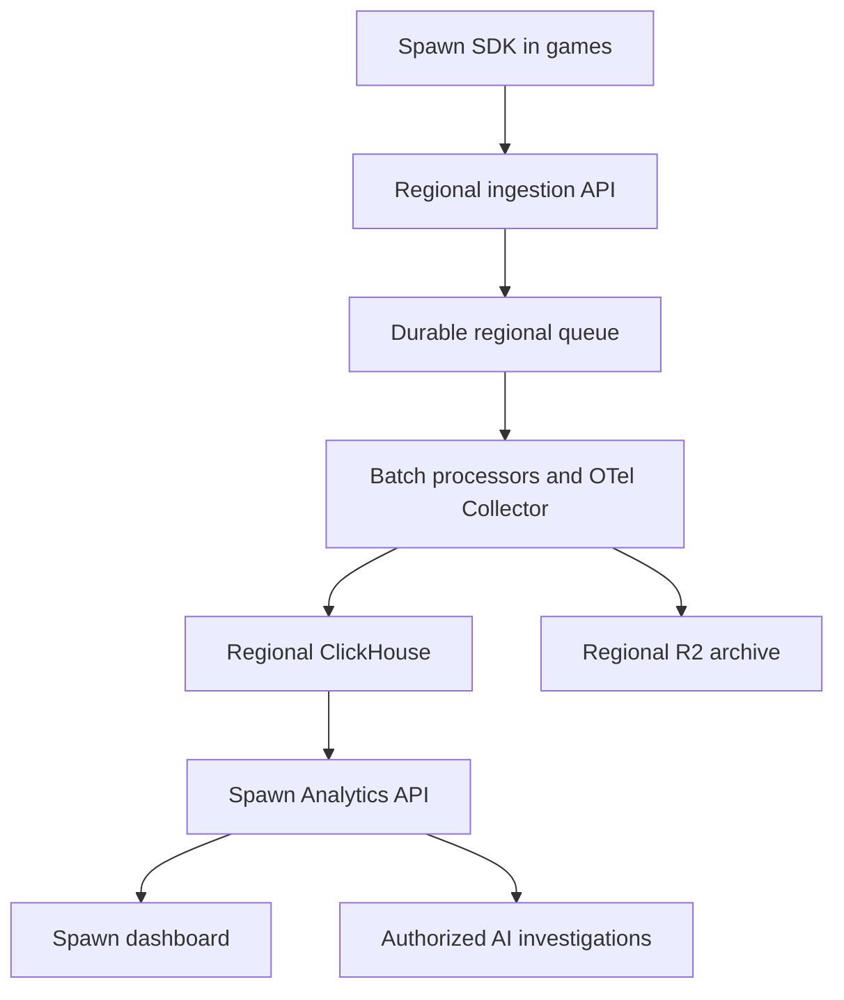

# Telemetry analytics architecture and regional routing

Documented 2026-10-14. Status: proposed architecture; implementation and production sizing remain pending. **Agreed requirement:** add EU telemetry endpoints and select telemetry endpoints based on the game server's deployment location.

This extends the implemented [telemetry logger](telemetry-design.md) to support the [Analytics experience](analytics-experience.md). The existing logger, tenant Durable Object storage and live event viewer remain the current implementation. ClickHouse, ClickStack, regional ingestion and the advanced Analytics backend described here have not been deployed or verified by this document.

## Recommended system

Use a self-hosted ClickHouse analytics backend, with ClickStack providing OpenTelemetry collection and an internal troubleshooting interface. SpawnKit retains its game SDK, authenticated Analytics API and customer dashboard. ClickStack supplies observability infrastructure; SpawnKit owns the definitions of active players, playtime, retention, release health and game progression.

[ClickStack](https://clickhouse.com/docs/clickstack/overview) combines ClickHouse, an OpenTelemetry Collector and the HyperDX interface, with MongoDB for application configuration and UI state. It supports self-managed deployment, telemetry search, trace exploration, dashboards and alerting. Its [Docker Compose deployment](https://clickhouse.com/docs/clickstack/deployment/docker-compose) is suitable for the initial integration pilot. Production topology, storage, backups and availability require separate validation.

| Component | Responsibility |
| --- | --- |
| Spawn SDK | Consented activity, session lifecycle, events, errors, measurements and trace context/spans |
| Regional ingestion API | Validate write credentials, derive tenant/environment/region from trusted configuration, redact and enforce quotas |
| Durable queue | Absorb bursts, batch delivery, retry transient failures and retain failed batches for recovery |
| Processors and OTel Collector | Validate versioned schemas, normalize records, export observability signals and write game analytics facts |
| ClickHouse | Query event history, sessions, performance distributions and player/release aggregates |
| R2 archive | Retain bounded raw-event archives for recovery and aggregate rebuilds under an explicit retention policy |
| Spawn Analytics API | Authorize project access, execute bounded queries and return dashboard-ready results with freshness/coverage metadata |
| Existing application database | Authoritative releases, deployment locations, issue workflow, alert configuration and investigation job state |
| HyperDX | Internal engineering troubleshooting; customer access continues through SpawnKit's API and dashboard |

This is a hybrid deployment. Cloudflare handles ingestion, queues and archives; dedicated Linux servers with persistent disks hold the searchable ClickHouse copy. Provider accounts remain platform-owned. Start with a shared regional service with enforced tenant boundaries, rather than a database server for every game. Isolate analytics workloads from customer game containers. The current Durable Objects can continue serving configuration/quota coordination while analytical event storage moves to the new service.

Cloudflare Queues supports batching, retries and external pull consumers. The bridge to the OTel Collector and ClickHouse is application integration work, not an assumed built-in connection. A successful ingestion response must mean durable queue acceptance; query availability is asynchronous and the dashboard must expose ingestion lag. [Queues documentation](https://developers.cloudflare.com/queues/)

## Data needed by the dashboard

| Feature | Collection additions | Backend additions |
| --- | --- | --- |
| Release health and comparison | Explicit session start/activity/end/outcome records; immutable release/build identity | Searchable release catalog, deployment/commit joins, adoption, issue-free session rates and performance aggregates |
| DAU, WAU, MAU and retention | Consented stable pseudonymous identity, first activity and active-day facts | Distinct identities across sessions/releases, mature acquisition cohorts and complete-day coverage |
| Hours played | Bounded activity intervals or heartbeats that exclude idle, paused and background time | Deduplicated active seconds, UTC-day splitting and session totals |
| Level completion | Attempt identity plus start/completion/outcome events | Completion linked to the original attempt cohort, including late completion |
| Performance and traces | Standard scene/load/save operations, actual spans and bounded frame-time distributions | Trace relationships and waterfalls; mergeable distributions for percentiles |
| Issues | Existing errors/breadcrumbs enriched with build identity | Source-map processing, stable grouping, regression detection, ownership and status history |
| AI investigation and alerts | Reuse authorized telemetry and release evidence | Persisted investigation jobs, scoped evidence tools, alert evaluation, quotas and delivery |

Keep the core logger small and add a typed game-analytics layer and renderer/lifecycle adapters. The generated CLI project should configure the regional endpoint and expose those APIs. Do not emit an event for every rendered frame. Source maps and release/commit metadata should come from the build/deployment pipeline, not be guessed from client events.

Product analytics collection must have a counting contract independent of diagnostic sampling. Show coverage for consent exclusions, delivery losses, quotas and missing partitions; sampled errors cannot establish a total-player or issue-free-session denominator. Use stable event IDs and deduplicate before incremental aggregates. ClickHouse background row merging alone must not be assumed to prevent double-counted materialized aggregates. Rebuild/reconciliation must produce the same results after retries and replay.

Seven-day raw retention can remain a product tier, but MAU, D30 retention and historical ranges require longer-lived facts/aggregates. Define raw, aggregate, archive and backup retention separately, together with deletion propagation. Follow the metric definitions in [Analytics](analytics-experience.md#game-metric-contract). ClickHouse's [product analytics guide](https://clickhouse.com/blog/building-product-analytics-with-clickhouse) provides a reference for event schemas and aggregates; our game definitions remain authoritative.

## EU endpoints and endpoint selection

**Agreed:** add EU telemetry endpoints and choose the endpoint from the game server's deployment location. Server location means the region recorded for the running game-server allocation, not the player's IP address, developer location or nearest CDN edge.

Proposed addresses, not provisioned services:

| Platform environment | EU ingestion base URL |
| --- | --- |
| Production | `https://telemetry.eu.spawnkit.cloud` |
| Internal staging | `https://telemetry.eu.staging.spawnkit.cloud` |
| Local regional testing | `https://telemetry.eu.local.spawnkit.cloud` |

The existing `/v1/logs` path is retained. Trace and metric paths are introduced only with corresponding ingestion support. DNS, certificates and routing must be verified before any regional address is advertised. See the [domain contract](domains.md#planned-regional-telemetry).

Proposed selection rules:

| Situation | Endpoint selection |
| --- | --- |
| Server allocated in an EU region | EU ingestion endpoint for that platform environment |
| Server allocated outside the EU | Endpoint mapped to that allocation's configured telemetry region; do not infer an EU route from a broad “Europe” label |
| One game running in several regions | Each server allocation uses its own regional endpoint; retain allocation/deployment identity on records |
| Browser connected to a game server | Use telemetry configuration for the selected server region, delivered by trusted runtime configuration or the server connection handshake |
| Browser before server selection | Use an explicit project/environment default telemetry region; do not guess from IP or silently switch to a global endpoint |
| Frontend-only game without a server | Use an explicit project/environment telemetry region; the default policy is an open product decision |
| Local development | Use local telemetry unless the developer explicitly configures a remote test endpoint |

Maintain a versioned provider-region-to-telemetry-region mapping in the control plane. The deployment/connection configuration supplies the endpoint, telemetry region, release identity and public write credential together. A browser write key is public configuration, not proof of a player's identity or truthful event content. The receiving service validates the credential's allowed project/environment/region and rejects mismatches before durable ingestion; arbitrary client attributes cannot redirect data into another tenant or region.

The SDK snapshots the destination with each queued batch. A server-region change affects subsequent capture and must not retarget records already queued for the previous region. Preserve stable event IDs across retries and reconnects. Historical data stays in its original region unless an explicit migration is designed; changing a setting must not copy it automatically. The existing SDK's fixed endpoint will need an explicit safe reconfiguration or instance-handoff contract.

## Proposed regional processing and storage boundary

The endpoint requirement is agreed. The following residency and failure policies are proposed engineering requirements to validate before advertising EU-only handling; this document is not a claim that the current platform already provides it.

- Route the EU lane to EU collectors, ClickHouse storage/replicas and archives. Include dead-letter messages, backups, temporary files and operational logs that contain payload data in the placement review.
- Create EU-restricted queues and matching dead-letter queues. Cloudflare documents that queue jurisdiction restricts queue storage and processing, while producers and consumers may still run elsewhere. Worker and consumer placement therefore need separate controls. Queue jurisdiction is chosen at creation. [Queue data location](https://developers.cloudflare.com/queues/configuration/data-location/)
- Use R2's EU jurisdiction restriction for the EU archive. A European location hint is best-effort placement and is insufficient for a residency guarantee. [R2 data location](https://developers.cloudflare.com/r2/reference/data-location/)
- An EU DNS name does not constrain HTTPS decryption or Worker execution by itself. Verify Regional Services availability, account entitlements and actual configuration when EU-only processing is required. [Regional Services](https://developers.cloudflare.com/data-localization/regional-services/)
- Retry or fail over within the permitted region. If it is unavailable, preserve the existing bounded buffering/drop behavior and expose loss/lag; do not silently send EU payloads to another jurisdiction.
- Keep dashboard caches, exports, AI evidence retrieval, model-provider processing and investigation results within the documented access/processing policy. EU storage alone does not establish an EU-only end-to-end AI workflow. Define which authorized users may retrieve data and where response processing occurs.
- Expose both the game server region and telemetry region in configuration/diagnostics. Preserve their distinction when a supported region maps to a broader telemetry deployment.

For a multi-region game, the Analytics API must query authorized regional stores and report partial coverage when a region is unavailable. Distinct players and retention cannot be calculated by summing regional DAU/MAU counts; use appropriately scoped identities and mergeable or deduplicated aggregates. Likewise, merge distributions instead of averaging regional p95 values. Cross-region reporting and identity linkage must respect the chosen processing policy, which remains open.

## Alternatives and operational ownership

SigNoz is another self-hostable OpenTelemetry/ClickHouse observability platform. It would still require SpawnKit's game-event contracts and analytics queries. [SigNoz architecture](https://signoz.io/docs/architecture/)

PostHog offers product analytics, but its current self-hosted deployment is officially unsupported. It is not the recommended foundation for this core platform service. Re-evaluate this tradeoff if the deployment/support model changes. [PostHog self-hosting](https://posthog.com/docs/self-host)

Self-hosting gives us control over data and integration, while making us responsible for upgrades, capacity, backups, recovery, isolation and on-call operations. Pin and review component versions and licenses before adoption. Measure ingestion volume, event size, retention, dashboard concurrency and regional replication before choosing instance sizes or committing pricing. A single-machine pilot is not a high-availability production deployment.

## Implementation sequence and acceptance

1. Specify versioned activity/session/span contracts and regional configuration. Add SDK and scaffold support without breaking existing event/error capture.
2. Deploy an isolated pilot with one instrumented game, regional ingestion, durable buffering, ClickHouse and R2 archival. Verify replay and recovery with stable event IDs.
3. Connect real aggregation endpoints to Overview, Players, Health, Explore and release history/comparison; preserve honest unavailable and incomplete-data states.
4. Verify EU/non-EU allocation routing, multi-region clients, pre-connection/default behavior, Sandbox isolation, region changes and regional outages. Assert that mismatched keys and forbidden cross-region fallbacks cannot enqueue payloads.
5. Compare dashboard metrics against deterministic ground truth: active-day identity, idle exclusion, midnight boundaries, duplicate/reordered events, upgrades, mature retention, missing coverage and long release histories.
6. Validate tenant access, bounded query cost, ingestion backpressure, load during recovery, regional placement and backup restoration. Establish operating budgets and retention/deletion policies before production rollout.
7. Add durable issue workflows, symbolication, AI investigation services and alert delivery on the verified data foundation. Keep mutation permissions separate from evidence access.

## Decisions still open

- Final production topology, cloud regions, capacity, availability targets and pricing.
- Frontend-only/default telemetry-region policy and mappings for supported non-EU regions.
- Retention tiers, migration of existing records/keys, permitted failover and cross-region reporting policy.
- Verified Cloudflare localization entitlements and AI processing locations for an EU-only offering.
- Exact pseudonymous identity lifecycle, guest/account linking and collection-coverage contract.

These are follow-up implementation decisions. They do not weaken the recorded requirement to add EU endpoints selected from server location.
